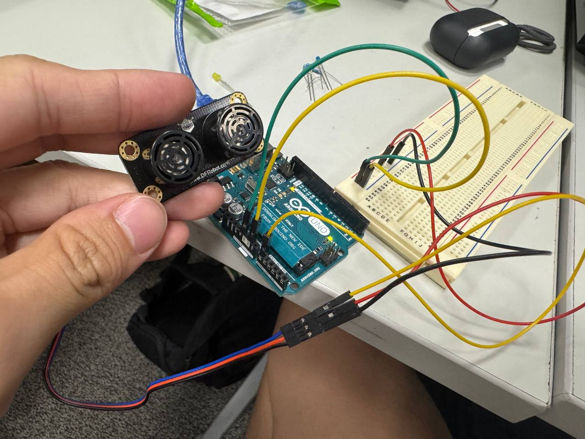

# Week 08 — Arduino Basics

---

### Activities

| Activity | What I Made                   |
| -------- | ----------------------------- |
| `8a`     | Three LEDs that light, blink and fade at different intervals. |
| `8b`     | Testing different sensors that use sound, touch and light. |

---

### This Week

Never used an Arduino before so this was a very interesting lesson. My lack of knowledge in electronics made it a little hard but it was still manageable.

---

### Output

### 8a — Light it Up


### 8b — Sensor Check


<!-- Drop a screenshot, photo, or GIF of something you made this week.
     Save it to a readme-assets/ folder inside this week's folder.
     Made more than one thing worth showing? Add more images. -->

---

<!-- ─────────────────────────────────────────────────────
     GOING FURTHER — if you want to document more, here are some ideas:

     ### 1a — Activity Name
     
     What you tried, what you discovered.

     ### 1b — Activity Name
     
     What you tried, what you discovered.

     ### 🧩 Something I Found Interesting
     A line of code, a technique, a happy accident — paste it here.
     ```js
     // your code here
     ```

     ### ❓ Questions I'm Sitting With
     Anything unresolved, something you want to revisit, or a rabbit hole you fell into.

     ### 🔗 References
     Links to anything that helped or inspired you this week.
     ───────────────────────────────────────────────────── -->
